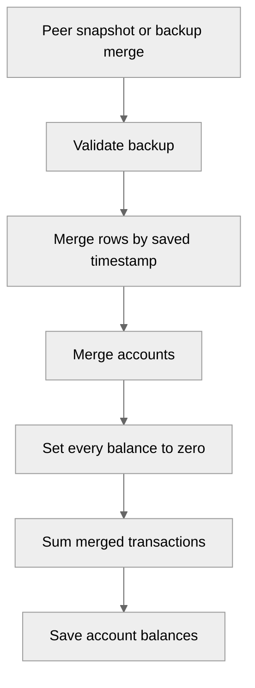

<!-- greptile_summary -->

<h2><a href="https://app.greptile.com/api/retrigger?id=76493536"><picture><source media="(prefers-color-scheme: dark)" srcset="https://greptile-static-assets.s3.amazonaws.com/badges/RetriggerDark.svg?v=2"><source media="(prefers-color-scheme: light)" srcset="https://greptile-static-assets.s3.amazonaws.com/badges/Retrigger.svg?v=2"></picture></a>Confidence Score: 0/5</h2>

<!-- greptile-risk -->

This PR is not ready to merge: the new account check blocks builds, and merging and bank-message parsing can produce wrong financial data.

<h2>Findings</h2>

1. &nbsp;**Account timestamp check blocks builds** <a href="https://github.com/juraev-exe/WhereDidItGoNew/pull/3#discussion_r4228605842">▶</a>
2. &nbsp;**Credit balances change signs** <a href="https://github.com/juraev-exe/WhereDidItGoNew/pull/3#discussion_r4228605854">▶</a>
3. &nbsp;**Bank messages lose their amounts** <a href="https://github.com/juraev-exe/WhereDidItGoNew/pull/3#discussion_r4228605859">▶</a>
4. &nbsp;**Synced balances are wrong** <a href="https://github.com/juraev-exe/WhereDidItGoNew/pull/3#discussion_r4209971622">▶</a>
5. &nbsp;**Budget warnings ignore rollover** <a href="https://github.com/juraev-exe/WhereDidItGoNew/pull/3#discussion_r4209971641">▶</a>
6. &nbsp;**Old repayments count again** <a href="https://github.com/juraev-exe/WhereDidItGoNew/pull/3#discussion_r4209971718">▶</a>
7. &nbsp;**New screens stay English** <a href="https://github.com/juraev-exe/WhereDidItGoNew/pull/3#discussion_r4209971731">▶</a>

<details><summary>Fix with agent prompt</summary>

`````markdown
### Issue 1
src/services/backup.ts:400
`mergeFromBackup()` reads `a.updatedAt` and `e.updatedAt`, but both records are typed as `Account`, which has no `updatedAt` field. These accesses fail TypeScript checks. Since `build` runs `vue-tsc --noEmit` first, web and native builds cannot finish. Remove this check or add and preserve account timestamps throughout account writes and backups.

### Issue 2
src/services/backup.ts:419-425
`mergeFromBackup()` now subtracts expenses and adds payments for every account type. Credit accounts use the opposite signs because their `balance` stores money owed. A credit account starting at zero with a $20 expense becomes -$20 after merging instead of $20 owed. Transfers into credit accounts are reversed too. Use the same credit-aware signs as `signedFlowDelta()` when applying merged transactions.

### Issue 3
src/services/smsParser.ts:201
The new date-removal pattern also removes valid amounts with two digits on each side of a decimal point. It removes `78.50` from the Alif sample and `34.20` from the Chase sample before amount detection. Those messages now return no draft; a message with another number can select that number instead. Require enough date context to distinguish dates from money before removing matches.

### Issue 4
src/services/p2pSync.ts:undefined-154
The new sync path merges transactions and stored account balances separately. If two devices start with $100 and record separate expenses of $10 and $20, both expenses remain after syncing. But each device copies the other's balance of $80 or $90 instead of showing $70. Apply the balance effects of merged transaction changes rather than copying one peer's balance.

### Issue 5
src/services/stats.ts:1363-1365
`computeBudgetRunway()` uses the base limit for percentages, warnings and exhaustion dates, but uses the rollover-adjusted remainder. A $100 budget with $50 carried forward and $110 spent appears exhausted despite having $40 left. Use `effectiveLimit` throughout, including the budget page totals and Wrapped budget checks.

### Issue 6
src/services/wrapped.ts:undefined-167
`debtsPaidTotal` sums lifetime `paidAmount` across all debts, including money lent to others. The monthly story repeats old repayments every month and can award Debt Crusher for money received rather than debt paid down. Count borrowed-debt repayments within `targetMonth`, or clearly label this as a lifetime total.

### Issue 7
src/features/debts/DebtPayoffPlanner.vue:undefined-182
The debt planner leaves most labels in English despite translating `debts.payoffTitle` into all three languages. Strategy names, the repayment budget and result sentences bypass `t()`. The SMS form and generated Wrapped badge text have the same gap. Move these strings into the locale files, including sentences with amounts and dates.

Note: If this suggestion doesn't match your team's coding style, reply to this and let me know. I'll remember it for next time!

---

For each issue above, determine whether it is valid and should be fixed. If so, fix it directly.
`````

</details>

<h3>Summary</h3>

This PR adds web billing, expanded settings, peer sync, encrypted backups, bank-message drafts, and financial reports.

The latest changes:
- Web users can buy Pro through RevenueCat in their browser.
- Settings can encrypt backups, pair devices, and erase local data.
- Home turns pasted bank messages into reviewable transaction drafts.
- Budgets can carry past balances forward and show how long funds may last.
- The debt planner compares Snowball and Avalanche payoff timelines.
- Insights adds flexible date ranges, reports, and a monthly Wrapped story.
- New finance tools have labels in English, Russian, and Tajik.
- Project notes and developer files track the new milestone work.

New findings cover a build failure, reversed credit balances, and valid money amounts removed as dates.

<details open><summary><h3>Diagram</h3></summary>


</details>

<!-- greptile_confidence_score:0 -->

<sub>Reviews (4) · Last reviewed commit: ["Fix remaining 8 greptile feedback issues"](https://github.com/juraev-exe/wherediditgonew/commit/e1d31863eeada65acd68a7a9b37700e28d256f20) · [Reviewed by Greptile](https://www.greptile.com/?utm_source=greptile_expert&utm_medium=github&utm_campaign=code_reviews&utm_content=juraev-exe/wherediditgonew)</sub>