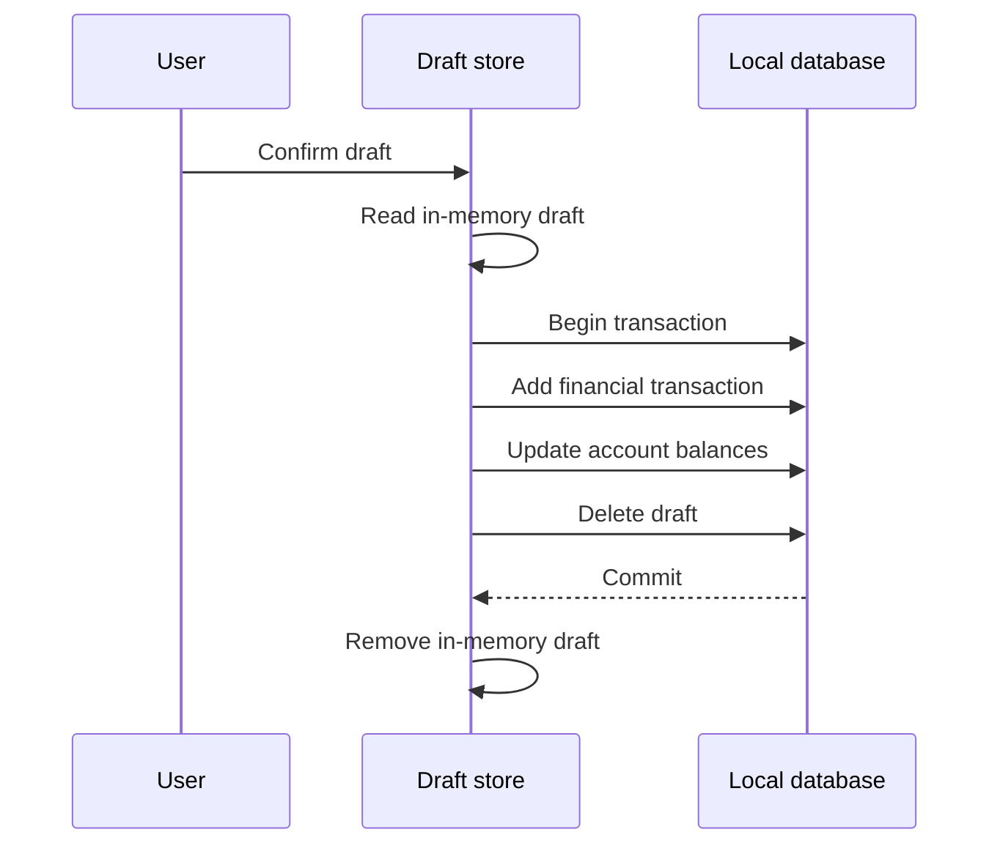

<!-- greptile_summary -->

<h2><a href="https://app.greptile.com/api/retrigger?id=76493536"><picture><source media="(prefers-color-scheme: dark)" srcset="https://greptile-static-assets.s3.amazonaws.com/badges/RetriggerDark.svg?v=2"><source media="(prefers-color-scheme: light)" srcset="https://greptile-static-assets.s3.amazonaws.com/badges/Retrigger.svg?v=2"></picture></a>Confidence Score: 0/5</h2>

<!-- greptile-risk -->

This PR should not merge yet because it can save wrong expense amounts, hide budget overruns, overwrite newer synced edits, and record drafts twice.

<h2>Findings</h2>

1. &nbsp;**Purchase dates become expense amounts** <a href="https://github.com/juraev-exe/WhereDidItGoNew/pull/3#discussion_r4228451683">▶</a>
2. &nbsp;**Empty budgets hide overspending** <a href="https://github.com/juraev-exe/WhereDidItGoNew/pull/3#discussion_r4228451695">▶</a>
3. &nbsp;**Sync overwrites newer edits** <a href="https://github.com/juraev-exe/WhereDidItGoNew/pull/3#discussion_r4209971610">▶</a>
4. &nbsp;**Synced balances are wrong** <a href="https://github.com/juraev-exe/WhereDidItGoNew/pull/3#discussion_r4209971622">▶</a>
5. &nbsp;**Budget warnings ignore rollover** <a href="https://github.com/juraev-exe/WhereDidItGoNew/pull/3#discussion_r4209971641">▶</a>
6. &nbsp;**Drafts can be recorded twice** <a href="https://github.com/juraev-exe/WhereDidItGoNew/pull/3#discussion_r4209971665">▶</a>
7. &nbsp;**Old repayments count again** <a href="https://github.com/juraev-exe/WhereDidItGoNew/pull/3#discussion_r4209971718">▶</a>
8. &nbsp;**New screens stay English** <a href="https://github.com/juraev-exe/WhereDidItGoNew/pull/3#discussion_r4209971731">▶</a>

<details><summary>Fix with agent prompt</summary>

`````markdown
### Issue 1
src/services/smsParser.ts:205
The new keyword-first pattern reads `Pokupka 12.05.2026 v Market. Summa: 850 RUB` as 12.05 and stops before reaching `850 RUB`. Confirming the draft saves the wrong expense and changes the account balance by the wrong amount. Exclude dates and card numbers before giving this pattern priority.

### Issue 2
src/services/stats.ts:1368-1372
Switching to `effectiveLimit` makes a budget with no money left report 0% spent and `on-track`. A $100 limit with a $100 carried deficit has an `effectiveLimit` of zero. Spending $110 now shows no warning, whereas the old calculation marked it over budget. Treat positive spending against a zero limit as over budget, and update the overall percentage too.

### Issue 3
src/services/p2pSync.ts:undefined-154
Both peers send their own snapshot and then overwrite matching rows through `mergeFromBackup()`. If one device has a newer transaction edit, it receives the stale copy while the other receives the newer copy. The devices swap versions rather than agree, and syncing again can reverse them. Compare `updatedAt` before applying matching rows on either peer.

### Issue 4
src/services/p2pSync.ts:undefined-154
The new sync path merges transactions and stored account balances separately. If two devices start with $100 and record separate expenses of $10 and $20, both expenses remain after syncing. But each device copies the other's balance of $80 or $90 instead of showing $70. Apply the balance effects of merged transaction changes rather than copying one peer's balance.

### Issue 5
src/services/stats.ts:1363-1365
`computeBudgetRunway()` uses the base limit for percentages, warnings and exhaustion dates, but uses the rollover-adjusted remainder. A $100 budget with $50 carried forward and $110 spent appears exhausted despite having $40 left. Use `effectiveLimit` throughout, including the budget page totals and Wrapped budget checks.

### Issue 6
src/stores/drafts.ts:undefined-74
`confirmDraft()` adds a transaction before removing the draft, without guarding against another confirmation. Two quick taps can both find the draft and create separate transactions. A crash between the writes also leaves an already-recorded draft available to confirm again. Claim and remove the draft in the same database transaction as the financial write.

### Issue 7
src/services/wrapped.ts:undefined-177
`debtsPaidTotal` sums lifetime `paidAmount` across all debts, including money lent to others. The monthly story repeats old repayments every month and can award Debt Crusher for money received rather than debt paid down. Count borrowed-debt repayments within `targetMonth`, or clearly label this as a lifetime total.

### Issue 8
src/features/debts/DebtPayoffPlanner.vue:undefined-182
The debt planner leaves most labels in English despite translating `debts.payoffTitle` into all three languages. Strategy names, the repayment budget and result sentences bypass `t()`. The SMS form and generated Wrapped badge text have the same gap. Move these strings into the locale files, including sentences with amounts and dates.

Note: If this suggestion doesn't match your team's coding style, reply to this and let me know. I'll remember it for next time!

---

For each issue above, determine whether it is valid and should be fixed. If so, fix it directly.
`````

</details>

<h3>Summary</h3>

This PR adds web billing, settings controls, peer sync, encrypted backups, bank-message drafts, and new financial reports. The latest changes address several earlier review findings.
- Pasted bank messages become transactions only after review.
- Settings can encrypt backups and sync data between devices.
- Insights compares spending pace, exports reports, and recaps each month.
- Budget limits can carry a surplus or deficit into the next month.
- The debt screen compares two ways to pay off loans.
- Billing routes web purchases through RevenueCat Web Billing.
- The activity calendar marks upcoming recurring payments.
- Planning records and small support edits change no finance flows.

<details open><summary><h3>Diagram</h3></summary>


</details>

<!-- greptile_confidence_score:0 -->

<sub>Reviews (3) · Last reviewed commit: ["Fix remaining 10 greptile feedback issue..."](https://github.com/juraev-exe/wherediditgonew/commit/eec942c1a9df118743e37bacef9b0390000a6a6b) · [Reviewed by Greptile](https://www.greptile.com/?utm_source=greptile_expert&utm_medium=github&utm_campaign=code_reviews&utm_content=juraev-exe/wherediditgonew)</sub>